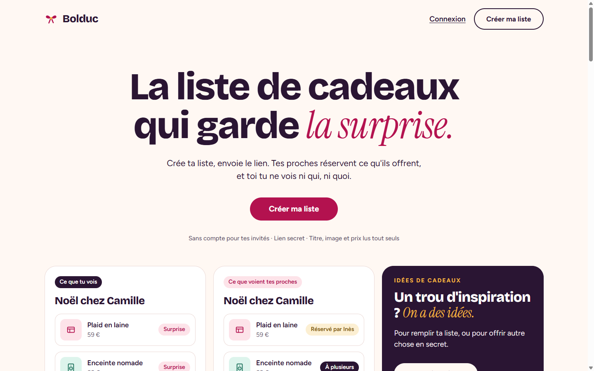
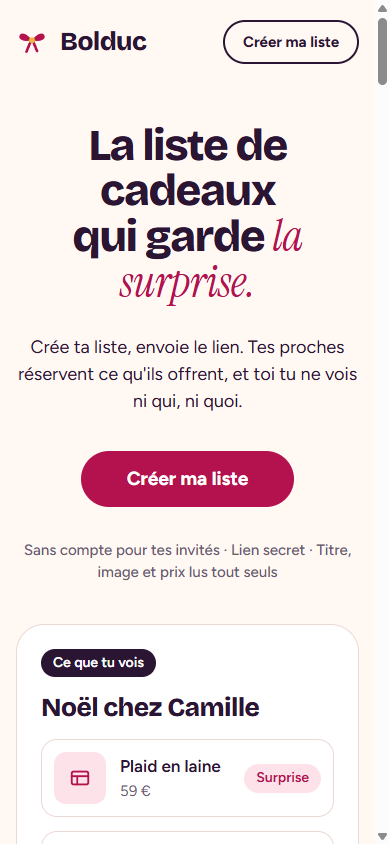

# Bolduc · Les listes de cadeaux, sans gâcher la surprise

🌐 **[bolduc.projectp.fr](https://bolduc.projectp.fr/)** · Jour 19 du défi **[30 jours, 30 projets](https://projectp.fr/)** · [Dépôt du défi](https://github.com/PierreWZK/30DaysProjects)

Stack : Laravel, Livewire, MySQL.

[](https://bolduc.projectp.fr/)

<p align="center">
  
</p>

Noël, anniversaire, mariage, crémaillère, naissance : on crée sa liste, on l'envoie par un lien, et les proches réservent ce qu'ils offrent. **Bolduc** garde la surprise : le propriétaire de la liste ne voit jamais qui a réservé quoi, ni les cadeaux « hors liste » que ses proches lui préparent.

📄 Les règles détaillées sont dans le [cahier des charges](CAHIER_DES_CHARGES.md).

## Au programme

- Listes par événement (thème, date, compte à rebours), partagées par lien secret ; pas de compte pour les invités.
- Ajout d'un cadeau en collant un lien de boutique : titre, image et prix lus automatiquement.
- Réservation sans spoiler, et **cadeau à plusieurs** avec une barre de participation.
- **Idées de cadeaux** : un catalogue d'inspiration pour remplir sa liste, ou pour offrir autre chose en secret.
- **Secret Santa** : tirage au sort avec exclusions.
- **Remerciements** après l'événement et **rappels par e-mail** avant.
- **Mode soirée** : *Qui m'a gâté ?* et *Devine ton cadeau*, deux jeux à indices pour le moment d'ouvrir les paquets.
- **Jeux du jour** : *Le Juste Prix* et *Paquet mystère*.

## Lancer en local

```bash
composer install
cp .env.example .env && php artisan key:generate
php artisan migrate --seed
npm install && npm run dev   # dans un second terminal
php artisan serve            # http://127.0.0.1:8000
```

## Mise en ligne

Bolduc est hébergé sur un VPS avec **[Coolify](https://coolify.io)** : **https://bolduc.projectp.fr**. Coolify redéploie le site à chaque push sur `master`.

| Élément | Réglage dans Coolify |
| --- | --- |
| **Application** | Dépôt GitHub `PierreWZK/Bolduc`, build pack **Dockerfile**, port 80 |
| **Image** | [`Dockerfile`](Dockerfile) : les assets Vite sont compilés avec Node, puis servis par FrankenPHP (Caddy + PHP 8.4) |
| **Serveur web** | [`docker/Caddyfile`](docker/Caddyfile) et [`docker/php.ini`](docker/php.ini) : fichiers cachés jamais servis, version de PHP masquée |
| **Après chaque déploiement** | `php artisan migrate --force && php artisan db:seed --class=IdeeSeeder --force && php artisan db:seed --class=DailyItemSeeder --force && php artisan optimize` |
| **Tâche planifiée** | `php artisan schedule:run`, chaque minute (`* * * * *`) : elle envoie les rappels J-7 à 9 h |
| **Base de données** | MySQL dans Coolify, reliée par la variable `DB_URL` |
| **Variables** | `APP_KEY`, `APP_URL=https://bolduc.projectp.fr`, `APP_ENV=production`, `APP_DEBUG=false`, `APP_LOCALE=fr`, `DB_CONNECTION=mysql`, `DB_URL`, `SESSION_SECURE_COOKIE=true`, et l'envoi des mails : `MAIL_MAILER=smtp`, `MAIL_HOST`, `MAIL_PORT`, `MAIL_USERNAME`, `MAIL_PASSWORD`, `MAIL_FROM_ADDRESS` ; jamais versionnées |
| **HTTPS** | Certificat Let's Encrypt géré par Coolify ; Laravel fait confiance à son proxy (`trustProxies` dans `bootstrap/app.php`) pour que les liens restent en `https://` |

Les deux seeders se relancent sans risque : ils mettent à jour sans effacer. Le compte de démonstration du `DatabaseSeeder` n'est jamais créé en production.

## Stack

Laravel · Livewire · MySQL.

## Avant de déclarer le projet terminé

> Rappel pour Claude : à faire sur chaque projet, sans que je le redemande (détail dans les sections 9 et 10 du cahier des charges).

- **Indexation** : `robots.txt`, `sitemap.xml`, balise canonical, données structurées JSON-LD (`WebApplication` rattachée à ProjectP) et lien « 30 jours, 30 projets » vers https://projectp.fr/ dans le pied de page. Vérifier en ligne, puis me rappeler de soumettre `https://bolduc.projectp.fr/sitemap.xml` dans Google Search Console.
- **Aperçu du lien** : image Open Graph stylisée 1200 × 630 aux couleurs du projet et balises `og:*` / `twitter:card`, vérifiées en ligne.
- **Vitrine** : la mise à jour de `30days30projects` (README et `projects.js`) se fait **après ma validation**.

---

## Le défi 30 jours, 30 projets

Un projet complet par jour pendant 30 jours, chacun en ligne sur son propre sous-domaine.

- 🗂️ **Tous les projets** : [projectp.fr](https://projectp.fr/)
- 💻 **Le dépôt du défi** : [github.com/PierreWZK/30DaysProjects](https://github.com/PierreWZK/30DaysProjects)
- ⬅️ **Jour précédent** : [Rituel, kanban](https://rituel.projectp.fr/)
- ➡️ **Jour suivant** : [Cartouche, ludothèque](https://cartouche.projectp.fr/)
